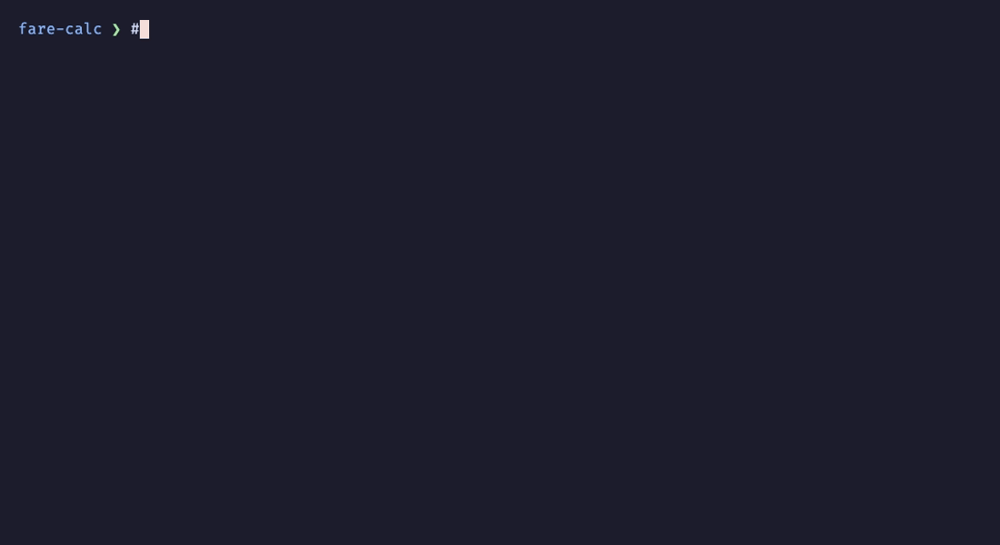

<h1 align="center">Hi, I'm Ranveer — aka <a href="https://ranveer-sequeira.vercel.app/">dedgeek</a> 👋</h1>

  

  
  
  
  
  

---

### 🧑‍💻 About Me

I'm an engineer who **owns outcomes, not just lines of code**. Today AI agents write a lot of the code —
my job is to frame the problem, design the system, **steer the agents**, and make sure what ships is correct, fast, and maintainable.
Based in **Gurugram, India**, I'm obsessed with **developer experience** and building the tools that make that loop faster for every engineer.

- 🏢 **Software Engineer II at [ixigo](https://www.ixigo.com/)** — solving frontend challenges at scale
- 🧩 Creator of **[Agentify](https://github.com/ixigo/agentify)** — ixigo's open-source memory & guardrail layer for AI coding agents
- 🗳️ Previously at **Devkraft Technologies**, maintaining the **Dekoder.com** ecosystem — an enterprise platform that served millions during India's elections (real-time data, complex caching, micro-frontends)
- 🤖 Focused on **AI-augmented development** — agents that work *alongside* developers, with engineers in the driver's seat
- ⌨️ **Terminal-first**: Neovim (LazyVim) + tmux + Ghostty. Fewer context switches, less friction between thought and shipped code.
- 🚀 **High agency**: ship, observe, iterate, refine. Hit a wall? Go around it, through it, or build a tool to demolish it.

> *The meta-problem I care about: how do we build better tools for building?*

### 🌱 Currently

- 🤖 Going deep on **agent workflows** — harnessing multiple coding agents (Claude Code, Codex, Gemini) as a team rather than a single autocomplete
- ⚡ Learning to **ship frontend work faster with agents in the loop** — specs → agent implementation → focused tests → human review
- 🛠️ Turning every friction point I hit into **DX tooling** (most of it ends up in Agentify)

---

### 🔦 Spotlight — Agentify @ ixigo

  

> **Switch agents. Keep the repo's working memory.**

I created and lead development of **Agentify**, ixigo's open-source CLI that keeps durable working context —
decisions, notes, session summaries, command failures, hot files — **with the repository** instead of inside one agent harness.

- 🧑‍💻 **Creator & primary maintainer**: [**200+ commits**](https://github.com/ixigo/agentify/commits?author=ranveersequeira) across [**195+ PRs**](https://github.com/ixigo/agentify/pulls?q=is%3Apr+author%3Aranveersequeira)
- 🧠 **Cross-session memory** — injected at session start, handoffs written at session end at zero model cost
- 🛑 **Guardrails** — flags a repeat of a previously failed command *before* it runs
- 🗂️ **Repo index** — structural queries (defs, refs, callers, impacts) instead of blind grepping
- 🎯 **Blast radius & focused tests** — `agentify risk` + `agentify test --since <ref> --run`
- 🔌 **Works everywhere** — Claude Code via hooks, Codex via guidance, any other agent over MCP
- 📏 **Measured, not hyped** — committed eval receipts; results published even when they show no difference

  

  
  
  
  

---

### 🛠️ Featured Open Source

| Project | What it does | Links |
|---|---|---|
| ⭐ **Agentify** | ixigo open-source CLI that turns any Git repo into an AI-agent-ready workspace — indexes code, writes agent-facing context, validates repo state, and wraps provider CLIs (Codex, Claude, Gemini, OpenCode). | [GitHub](https://github.com/ixigo/agentify) · [Docs](https://ixigo.github.io/agentify/) |
| 🤖 **ai-agent-workflow** | Structures AI tool usage into a team of specialist agent personas and enforces a disciplined dev workflow via engineered process prompts and rules. | [npm](https://www.npmjs.com/package/ai-agent-workflow) |
| 🔍 **react-analyzer** | Onboard onto any React-ecosystem project fast by analyzing its dependencies, tooling, and configs. | [npm](https://www.npmjs.com/package/@ranveersequeira/react-analyzer) |
| ⚡ **vite-sane-cli** | Scaffold Vite projects with sane defaults — Tailwind, Ant Design, MUI, Redux Toolkit. | [npm](https://www.npmjs.com/package/vite-sane-cli) |

<b>More projects</b>

| Project | Description | Link |
|---|---|---|
| **MIRA** | Full-stack project management app (Next.js, Prisma, PostgreSQL, TypeScript) | [Live](https://mira-my-jira.vercel.app/signin) |
| **XFlix** | Video sharing platform with uploads via external links | [Live](https://ranv-xflix.netlify.app/) |
| **QKart** | E-commerce application | [Live](https://ranv-qkart.netlify.app/) |
| **CatWiki** | Cat breeds explorer built on open-source APIs | [GitHub](https://github.com/ranveersequeira/catwiki) |

---

### 💼 Experience

| Role | Company | When |
|---|---|---|
| **Software Engineer II** | [ixigo](https://www.ixigo.com/) | Jan 2026 — Present |
| Software Developer (Frontend) | [Devkraft Technologies](https://www.devkraft.co.in/) | Sept 2023 — Dec 2025 |
| Software Developer Intern | [Devkraft Technologies](https://www.devkraft.co.in/) | Sept 2021 — Sept 2023 |
| Teaching Assistant | [Crio.do](https://www.crio.do/) | Sept 2021 — Dec 2021 |

📄 [Resume](https://drive.google.com/file/d/1VUBY4yr0-PI9ysn5waZhjKeMSbnlsu8O/view?usp=sharing)

---

### 🧰 Tech Stack

**Frontend**
 

**Backend**
 

**DevOps**
 

**AI**
 

---

### ⌨️ My Setup

  
  
  
  
  
  
  

🗃️ Every config lives in my **[dotfiles](https://github.com/ranveersequeira/dotfiles)** — managed with chezmoi, bootstrapped by a Brewfile.

---

### ✍️ Latest Writing

- 📝 [**Save Your Parents' Mental Health and Wellbeing**](https://ranveer-sequeira.vercel.app/) — *Your child is not competing with BJP or Congress. They are competing with your phone.*

---

### 📊 GitHub Stats

  

  
  

  

  <picture>
    <source media="(prefers-color-scheme: dark)" srcset="https://raw.githubusercontent.com/ranveersequeira/ranveersequeira/output/github-snake-dark.svg" />
    <source media="(prefers-color-scheme: light)" srcset="https://raw.githubusercontent.com/ranveersequeira/ranveersequeira/output/github-snake.svg" />
    
  </picture>

---

  <i>👯 Open to collaborating on dev tools, AI agent tooling & DX infra — <a href="mailto:ranveersequeira@gmail.com">say hi</a>.</i>

